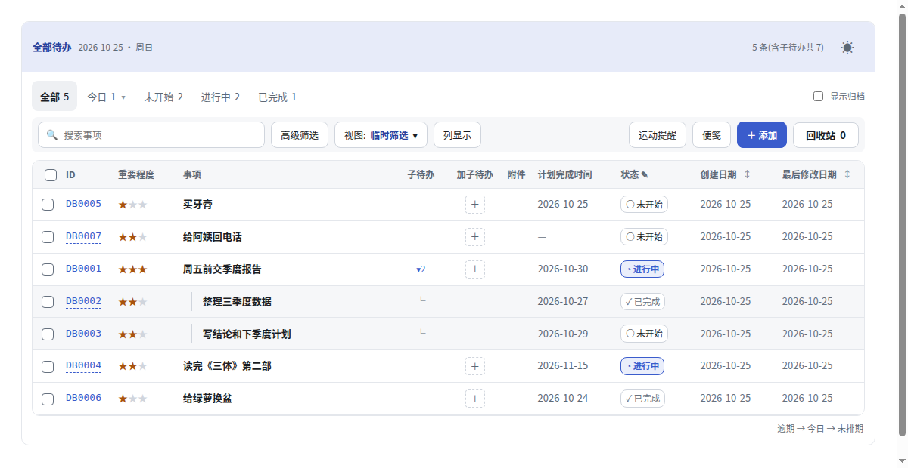
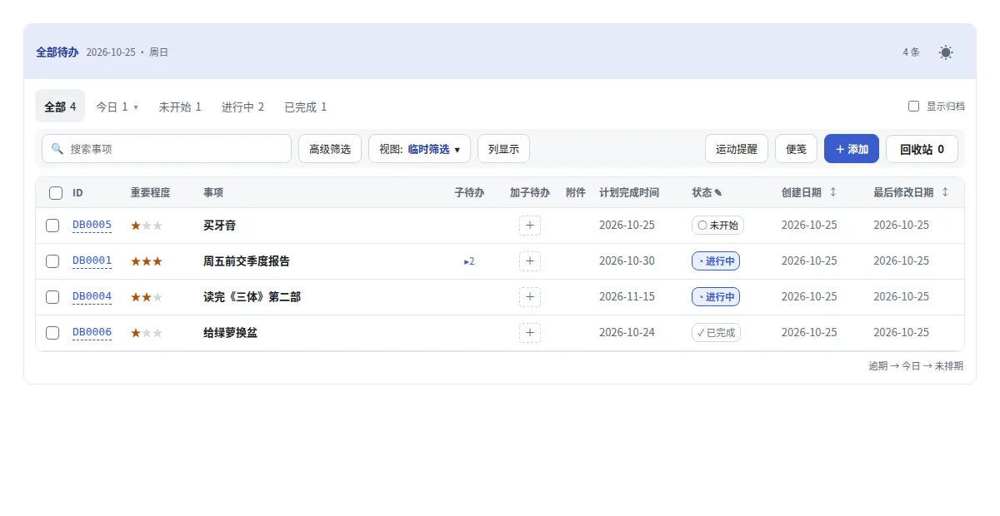
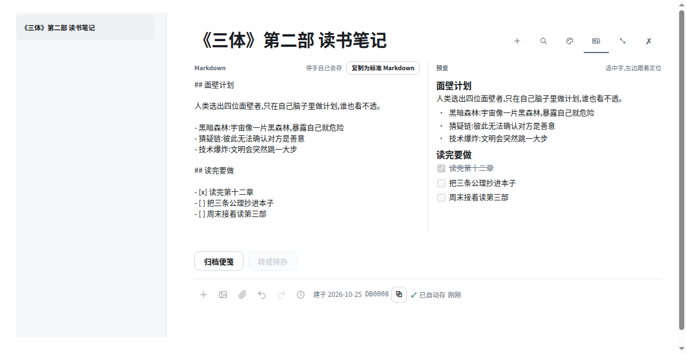
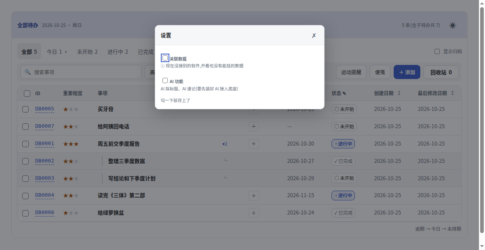
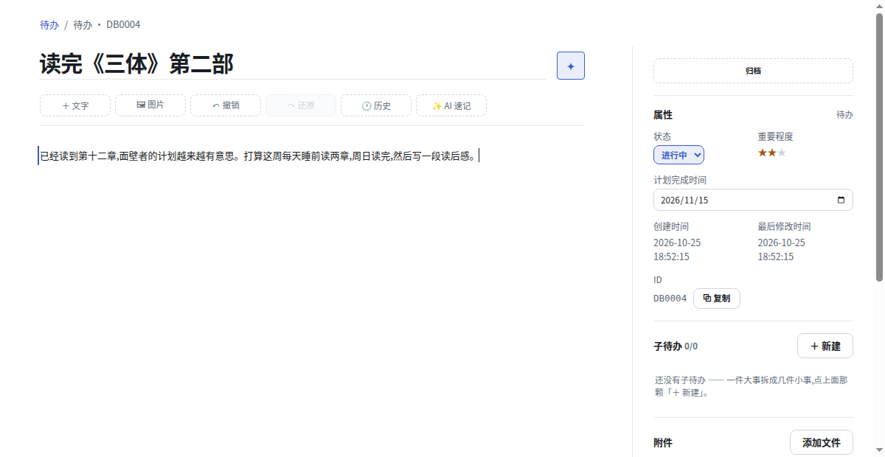
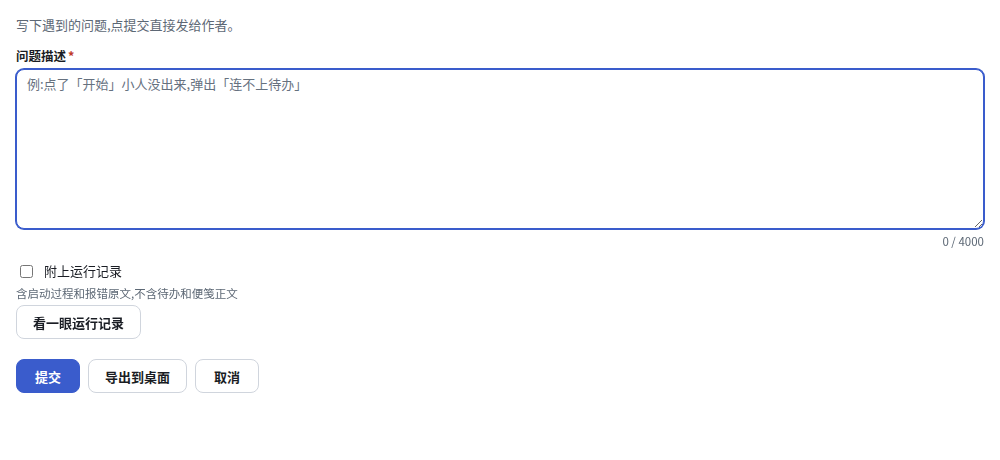

# 桌角(deskcorner)

在自己电脑上用的待办 + 便笺:一个 Python 小服务加一张网页,数据存在本机的一个 SQLite 文件里。除了你自己接上的 AI 功能(会把要整理的那段文字发给你配的模型服务),不连任何云。

- 待办可以分层(主待办下挂子待办)、归档、批量改、进回收站再还原
- 正文按块编辑(段落、列表、勾选、代码、表格、图片和附件),能和 Markdown 来回转
- 便笺可以单独开成小窗、钉住
- 每次修改留历史,能回到旧版本
- 可选:久坐提醒的运动小人(装了桌角到点自己弹;只开网页时要你自己的桌面端定时调 `/api/move` 的 `下一次`,不然不会弹)、AI 速记和 AI 拟标题(见下面「AI 功能」)

下载:<https://github.com/bibi8bi/deskcorner/releases>

## 下载安装

Windows:在上面的下载页拿 `deskcorner-Setup-<版本>.exe`,双击安装。待办数据存在你的用户目录里,卸载软件不会删掉它。

## 怎么用

### 待办


点「＋ 添加」写一条待办,回车就存上。一条下面还能挂子待办;做完标成「已完成」;删掉的先进「回收站」,点开能还原。

「搜索事项」按字找,「高级筛选」按字段组合条件筛,「列显示」挑表格里出哪几列。每次修改都留历史,能回到旧版本。



### 便笺



点「便笺」随手记一张:只写正文,第一行自动当事项名,以后点「转成待办」再补日期和星级。

正文按块写:段落、列表、勾选、代码、表格、图片和附件都行。点右上角「Markdown」分成左右两栏,左边写原文、右边看排版。

### 桌面小人


软件开着时,桌面角落常驻一个小人:

- 单击:记一张便笺
- 双击:打开待办
- 把文字或文件拖到它身上:直接存成便笺
- 右键:更多(运动提醒设置、小人大小、隐藏)

隐藏了想找回来:菜单栏「设置 → 显示桌面标志」。

### 运动提醒


坐久了小人会出来提醒你起来动一动,点「开始」跟着做一轮。开关、工作时段、今天做了几轮,在待办页「运动提醒」里设;右键小人也能进。

### 设置



菜单栏「设置」里:

- 待办设置…:关联数据、AI 功能开不开(出厂都关着)
- 外观:跟随系统、浅色、深色
- 显示桌面标志、开机时自动启动

AI 功能要先在「设置 → AI接入底座…」里填你自己的模型服务密钥(DeepSeek、Groq 等);打开后待办上多出「AI 拟标题」「AI 速记」两颗钮,整理的那段文字会发给你配的那家模型服务。



### 反馈问题



菜单栏「帮助 → 反馈问题…」:写下遇到的问题,点提交直接发给作者。可以勾「附上运行记录」帮作者查是哪一步出的错,发之前能先看一眼会发什么。

## AI 功能(可选)

「AI 速记」(把随手记的一段话整理成正文)和「AI 拟标题」两个按钮走包里带的 **AI 接入底座**(`ai-base/`):你在底座面板里填自己的 API 密钥,底座负责调模型。
没填时两个按钮会说清该去哪儿配,其余功能照常用。

从源码跑时,第一次照这个顺序来:

```bash
python3 ai-base/panel.py --功能声明 插件.json   # 第一次必须带这个参数;在打开的面板里填 DeepSeek 或 Groq 的密钥
python3 应用/服务.py                            # 另开一个终端
```

- 密钥也能用命令行填:`python3 ai-base/ai.py 设密钥 DeepSeek <密钥>`。
- 面板里还能从名册里挑别家,或者自己加一家 OpenAI 兼容的地址。
- 第一次之后起面板不用再带 `--功能声明`。要是没带它就先用了 AI 钮,按钮会说「功能表里没有」:补跑一次带 `--功能声明` 的就好。
- 底座放别处也行:在仓根新建 `.ai_base`,写一行底座文件夹的完整路径(或者设环境变量 `AI_BASE_DIR`)。

## 从源码跑

不想装安装包、或者不在 Windows 上,也能直接跑源码。只要 Python 3,不用装别的包(本仓在 Linux 的 Python 3.12、Windows 的 Python 3.10 上测过)。

```bash
python3 应用/服务.py              # 只在本机开:http://127.0.0.1:8899/
python3 应用/服务.py --lan        # 同一个 wifi 下的手机也能开(没有登录,别在公共网络上这么用)
python3 应用/服务.py --数据目录 ~/待办数据 --端口 9000   # 数据放别处、换端口
```

要停就在开着它的那个终端里按 `Ctrl+C`。

第一次跑会自动建库。默认库在 `数据/待办.db`(带 `--数据目录 D` 时在 `D/待办.db`),备份就拷这一个文件。

## 配置

`应用/config.json`,改完重启服务。

| 项 | 干什么 | 默认 |
|---|---|---|
| `数据目录` | 数据放哪个文件夹(相对路径按 `应用/` 算;`--数据目录` 优先) | `../数据` |
| `待办db_path` | 库文件名(相对路径按数据目录算) | `待办.db` |
| `端口` | 服务端口(`--端口` 优先) | `8899` |
| `实体库` | 别的软件的库,只读挂上来判「这条待办挂的东西还在不在」 | 空 = 只有本机这一份待办 |
| `跨站放行端口` | 同一台机器上别的页面要调待办接口时,把它的端口写进来 | 空 |
| `AI敏感内容` | 开着时 AI 底座把待办正文当敏感内容,只拨它认定能处理敏感内容的那一家(出厂底座里没有这一家) | `false` |

想让待办挂上你别的软件里的数据(任务、客户、订单……),照 [接自己的库.md](接自己的库.md) 接。

## 第三方

- [Prism](https://prismjs.com/) 1.30.0,代码段上色,MIT 许可证,见 `应用/页面/第三方/prism-LICENSE.txt`
- 运动提醒的小人图(`应用/页面/小人/恶魔/`),都在 ComfyUI 里做:
  - 站姿:作者自己训练的 LoRA 生成(训练图是作者用 ChatGPT 出的虚构角色),底模 [Z-Image-Turbo](https://huggingface.co/Tongyi-MAI/Z-Image-Turbo)(Apache 2.0),出图工作流改自 catlover1937 的工作流(已获原作者同意)
  - 待机、哈欠、打盹、睡着、惊醒、拎起、提醒、欢呼这几段:Qwen-Image-Edit 从站姿改出关键帧,Wan2.2 生成两个关键帧之间的过渡,再抠成透明底
  - 骨盆前后摇、坐姿转体、搓腰、站立后仰、夹臀、走动、顺时针揉腹、按足三里:同上(Qwen-Image-Edit 关键帧 + Wan2.2 过渡),另用 RIFE 插帧,BiRefNet 或绿幕抠成透明底
  - 腹式呼吸、呼吸收紧、转脚踝 + 踮脚、拍打大腿外侧:姿势取自 Google Flow 生成视频里抽出的骨架,画面由 Wan2.2 Animate 照站姿参考图重画,再抠成透明底

## 许可证

MIT,见 `LICENSE`。
